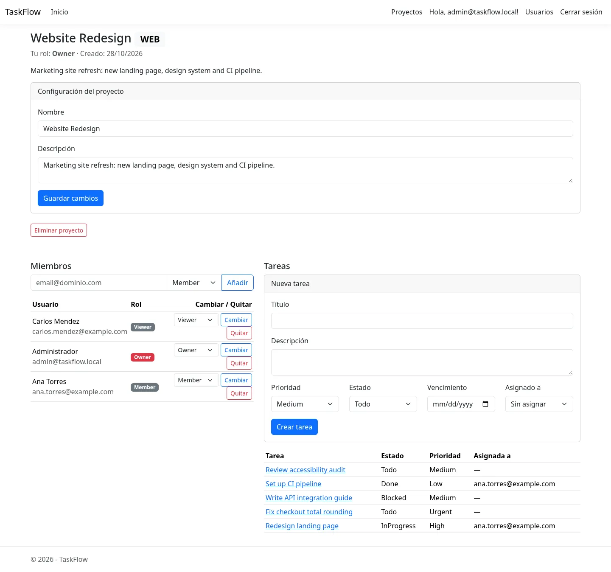
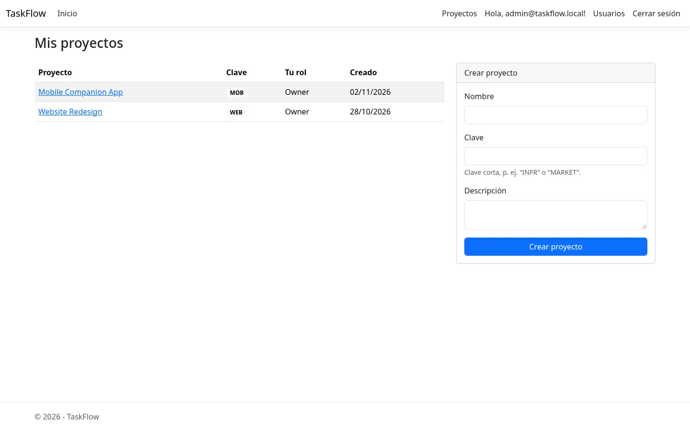
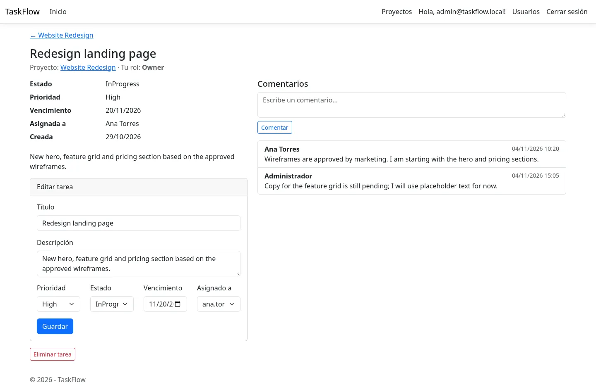
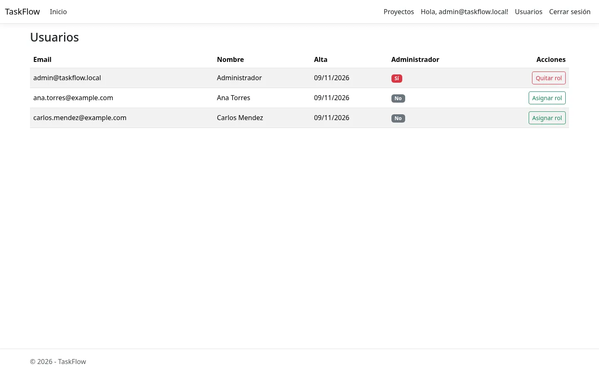
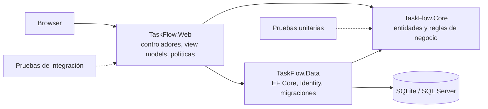

# TaskFlow

Aplicación web de gestión de tareas y proyectos construida sobre una arquitectura .NET en capas, con acceso por roles, autenticación endurecida y pruebas de integración.

[Español](README.es.md) · [English](README.md)




## Descripción general

TaskFlow organiza el trabajo en proyectos y tareas. Cada proyecto tiene su propia lista de miembros con cuatro roles y un conjunto de reglas que decide quién puede crear, editar, eliminar o comentar. La autenticación la resuelve ASP.NET Identity y toda petición fuera de las páginas públicas exige un usuario autenticado.

El proyecto es deliberadamente backend: tres proyectos con una sola dirección de dependencia, reglas de autorización en la capa de dominio y 152 pruebas automatizadas, 60 de ellas ejecutadas contra el pipeline HTTP real con `WebApplicationFactory`.

## Funcionalidades

### Cuentas y sesiones
- Registro con confirmación de correo, inicio y cierre de sesión
- Bloqueo de cuenta tras cinco intentos fallidos (15 minutos)
- Cookie de sesión deslizante de 12 horas, con revalidación del security stamp cada 5 minutos
- Rol global de administrador, separado de la pertenencia a proyectos

### Proyectos y permisos
- Creación de proyectos con una clave única de 2 a 10 caracteres; el creador queda como owner
- Alta de miembros por correo y cambio de su rol
- Cuatro roles de proyecto con reglas explícitas para tareas, miembros y configuración
- Un proyecto siempre conserva al menos un owner; solo un owner puede otorgar ese rol
- Solo un owner puede eliminar un proyecto

### Tareas
- Tareas con título, descripción, estado, prioridad, vencimiento y responsable
- El responsable debe ser miembro del proyecto
- Las transiciones de estado se validan en el dominio (`Todo → InProgress → Done`, con estados bloqueados)
- Comentarios en las tareas, visibles para todos los miembros del proyecto
- Toda lectura y escritura queda acotada a la pertenencia al proyecto: los identificadores de otro proyecto devuelven 404

### Administración
- Área de administración para listar usuarios y otorgar o retirar el rol de administrador
- Un administrador no puede quitarse el rol a sí mismo, lo que evita dejar la instancia sin acceso

### Seguridad y operación
- Validación global de antiforgery y exigencia global de autenticación
- Límite de 5 peticiones por minuto por IP en inicio de sesión y registro
- CSP, `X-Frame-Options`, `X-Content-Type-Options` y `Referrer-Policy` en cada respuesta
- HSTS y forwarded headers en producción
- Logging estructurado con Serilog a consola y archivo rotativo
- Migraciones de EF Core aplicadas automáticamente al arrancar

## Capturas

| Proyectos | Detalle de tarea |
|---|---|
|  |  |



## Stack

| Capa | Tecnología |
|---|---|
| Web | ASP.NET Core MVC (.NET 10) |
| Dominio | TaskFlow.Core: entidades, enums, reglas de permisos y transiciones |
| Datos | EF Core 10, ASP.NET Identity, SQLite (por defecto) o SQL Server |
| Logging | Serilog (consola + archivo rotativo) |
| Pruebas | xUnit, `WebApplicationFactory`, coverlet |

## Arquitectura



Las dependencias apuntan hacia adentro: `Web → Data → Core`. `Core` no referencia ningún framework, así que las reglas de permisos y las transiciones de estado se prueban sin base de datos ni servidor web.

```text
src/
  TaskFlow.Core/       Entidades, enums y reglas. Sin dependencias.
  TaskFlow.Data/       DbContext, configuraciones, migraciones y usuario de Identity.
  TaskFlow.Web/        Controladores MVC, vistas, view models y configuración de seguridad.
tests/
  TaskFlow.UnitTests/        92 pruebas: reglas, contratos de enums, validación de modelos.
  TaskFlow.IntegrationTests/ 60 pruebas: flujos HTTP, permisos, cabeceras de seguridad.
```

### Matriz de permisos

| Acción | Viewer | Member | Manager | Owner |
|---|:---:|:---:|:---:|:---:|
| Ver el proyecto y sus miembros | sí | sí | sí | sí |
| Crear tareas | no | sí | sí | sí |
| Editar tareas propias | no | sí | sí | sí |
| Editar tareas de otros | no | no | sí | sí |
| Comentar | no | sí | sí | sí |
| Gestionar miembros | no | no | sí | sí |
| Cambiar la configuración del proyecto | no | no | sí | sí |
| Eliminar el proyecto | no | no | no | sí |
| Otorgar el rol owner | no | no | no | sí |

## Puesta en marcha

### Requisitos

- [.NET SDK 10.0](https://dotnet.microsoft.com/download)
- No hace falta un servidor de base de datos: SQLite es el proveedor por defecto.

### Ejecutar en local

```bash
git clone https://github.com/Bryanrf22/TASKFLOW.git
cd TASKFLOW

dotnet restore TaskFlow.slnx
dotnet run --project src/TaskFlow.Web
```

Abre <http://localhost:5276>. La base de datos se crea y se migra en el primer arranque.

### Crear el primer administrador

La aplicación siembra un administrador al arrancar cuando están configurados `Seed:AdminEmail` y `Seed:AdminPassword`. Usa user secrets para que las credenciales no lleguen al repositorio:

```bash
dotnet user-secrets --project src/TaskFlow.Web set "Seed:AdminEmail" "admin@example.com"
dotnet user-secrets --project src/TaskFlow.Web set "Seed:AdminPassword" "ChangeMe#2026"
dotnet run --project src/TaskFlow.Web
```

La contraseña de siembra debe tener al menos 12 caracteres, una mayúscula, una minúscula, un dígito y un símbolo. La siembra es idempotente: crea el usuario solo si no existe y siempre asegura el rol de administrador.

### Probar la confirmación de correo

`Security:RequireEmailConfirmation` vale `true` por defecto y el `IEmailSender` incluido solo escribe el mensaje en el log. En Development, la página de confirmación del registro también muestra el enlace directamente. Para probar en local puedes usar ese enlace o desactivar el requisito:

```bash
dotnet user-secrets --project src/TaskFlow.Web set "Security:RequireEmailConfirmation" "false"
```

## Configuración

| Clave | Valor por defecto | Para qué sirve |
|---|---|---|
| `Database:Provider` | `Sqlite` | `Sqlite` o `SqlServer`. Producción usa `SqlServer` por defecto. |
| `ConnectionStrings:Default` | `Data Source=taskflow.db;Cache=Shared;Foreign Keys=True` | Archivo SQLite o cadena de conexión de SQL Server. |
| `TF_CONNECTION_STRING` | — | Variable de entorno que reemplaza la cadena de conexión cuando el proveedor es SQL Server. |
| `Security:RequireEmailConfirmation` | `true` | Exige correo confirmado antes de iniciar sesión. |
| `Seed:AdminEmail` | — | Correo del administrador sembrado. |
| `Seed:AdminPassword` | — | Contraseña del administrador sembrado. |
| `Serilog:*` | consola + `Logs/taskflow-.log` | Niveles y destinos del log. |

Las variables de entorno usan doble guion bajo, por ejemplo `Database__Provider=SqlServer` o `Seed__AdminEmail=admin@example.com`.

### Usar SQL Server

```bash
export Database__Provider=SqlServer
export TF_CONNECTION_STRING="Server=localhost;Database=TaskFlow;User Id=sa;Password=Your_password123;TrustServerCertificate=True"
dotnet run --project src/TaskFlow.Web
```

`appsettings.Production.json` ya selecciona SQL Server, así que un despliegue en producción solo necesita una cadena de conexión válida.

### Migraciones

Las migraciones se aplican automáticamente al arrancar. Para crear una nueva:

```bash
dotnet ef migrations add MyChange \
  --project src/TaskFlow.Data \
  --startup-project src/TaskFlow.Web
```

## Pruebas

```bash
dotnet test TaskFlow.slnx
```

Resultado actual: **152 pruebas en verde**. Las unitarias cubren reglas de permisos, transiciones de estado, contratos de enums y validación de view models. Las de integración recorren registro, confirmación, login, bloqueo, rate limiting, cabeceras de seguridad, ciclo de vida de proyectos, cambios de rol, acceso entre proyectos, CRUD de tareas y comentarios.

## Docker

```bash
docker build -t taskflow .

# Demo autocontenida con SQLite y volumen persistente
docker run --rm -p 8080:8080 \
  -e Database__Provider=Sqlite \
  -e ConnectionStrings__Default="Data Source=/data/taskflow.db;Cache=Shared;Foreign Keys=True" \
  -e Seed__AdminEmail="admin@example.com" \
  -e Seed__AdminPassword="ChangeMe#2026" \
  -v taskflow-data:/data \
  taskflow
```

La imagen corre con el usuario `app`, no root, y expone el puerto 8080. `appsettings.Production.json` selecciona SQL Server por defecto; el comando anterior es autocontenido porque reemplaza `Database__Provider` por `Sqlite`. Para SQL Server, deja `Database__Provider=SqlServer` y pasa `TF_CONNECTION_STRING`.

## Integración continua

`.github/workflows/build.yml` ejecuta restore, build y test en cada push a `main` y en cada pull request.

## Decisiones de diseño

- **SQLite por defecto.** La aplicación corre con un comando y sin servidor de base de datos, algo que importa cuando alguien clona el repositorio para revisarlo. SQL Server queda a una clave de configuración.
- **Reglas en el dominio, no en los controladores.** `Permissions` y `TaskStatusTransitions` son clases estáticas con pruebas unitarias. Los controladores traducen resultados HTTP; no son dueños de las reglas.
- **Pruebas de integración en vez de repositorios simulados.** Los errores de autorización suelen aparecer en el límite entre la consulta de pertenencia, las consultas de EF Core y el pipeline de filtros. `WebApplicationFactory` prueba el camino real.
- **404 en lugar de 403 para recursos ajenos.** Quien no es miembro de un proyecto no puede saber si existe. El 403 se reserva para miembros a los que les falta un rol.
- **Antiforgery y autenticación como filtros globales.** Los controladores nuevos quedan protegidos por defecto en vez de depender de anotar cada acción.

## Limitaciones conocidas

- Los textos de la interfaz están en español; el código y la documentación, en inglés.
- El envío de correo es un stub de logging, no una integración SMTP.
- El rate limiting y el almacenamiento son locales al proceso; un despliegue con varias instancias necesita un limitador distribuido y una base de datos compartida.
- No hay actualizaciones en tiempo real; la página refleja los cambios al recargar.
- Es monoinquilino: no existe una capa de organización por encima de los proyectos.
- SQLite está pensado para desarrollo local y demos, no para tráfico de producción concurrente.

## Licencia

MIT. Ver [LICENSE](LICENSE).
