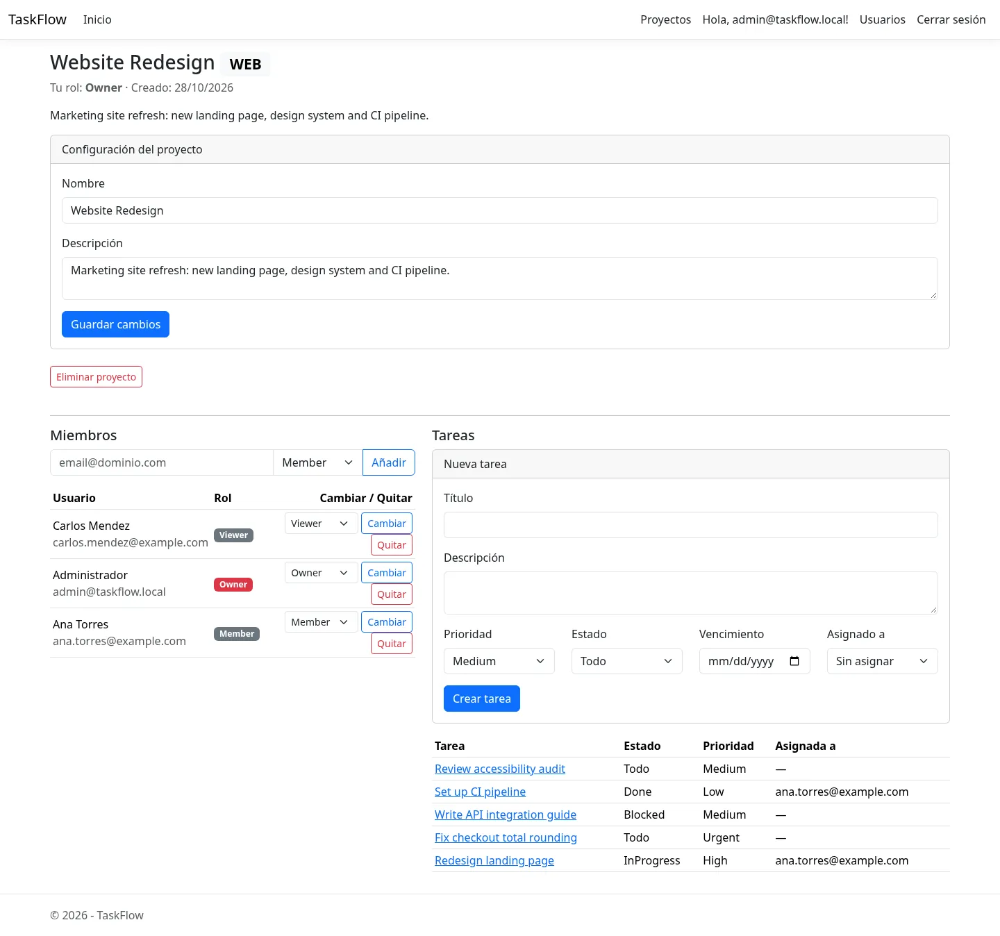
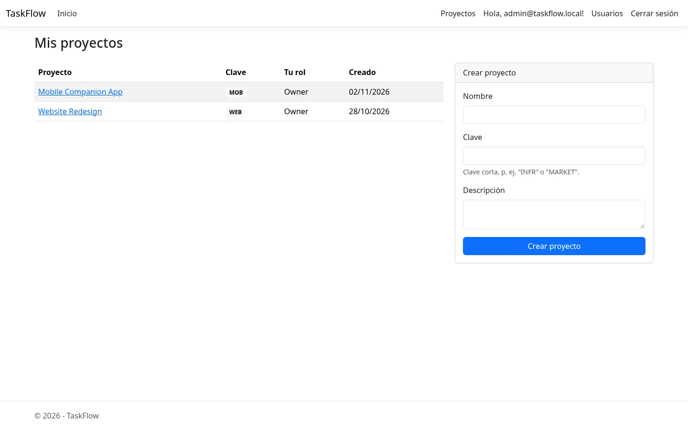
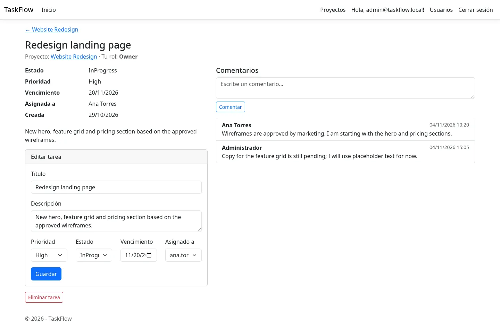
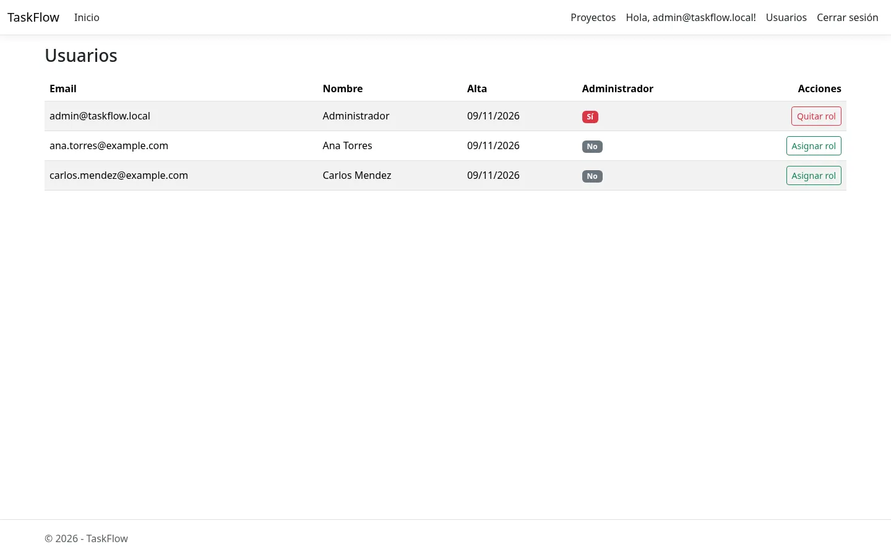
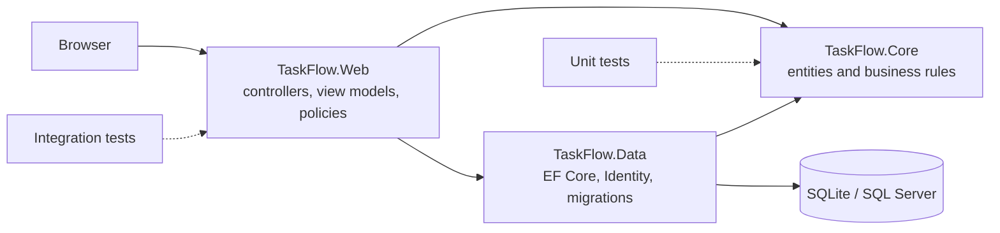

# TaskFlow

Task and project management web app built on a layered .NET architecture, with role-based access, hardened authentication and integration tests.

[English](README.md) · [Español](README.es.md)




## Overview

TaskFlow organizes work into projects and tasks. Each project has its own member list with four roles and a set of rules that decide who can create, edit, delete or comment. Authentication is handled by ASP.NET Identity, and every request outside the public pages requires a signed-in user.

The project is intentionally backend-focused: three projects with a single dependency direction, authorization rules in the domain layer, and 152 automated tests, 60 of them running against the real HTTP pipeline with `WebApplicationFactory`.

## Features

### Accounts and sessions
- Registration with email confirmation, login and logout
- Account lockout after five failed attempts (15 minutes)
- Sliding session cookie, 12-hour lifetime, security stamp revalidation every 5 minutes
- Global admin role, separate from project membership

### Projects and permissions
- Create projects with a unique 2–10 character key; the creator becomes the owner
- Add members by email and change their role
- Four project roles with explicit rules for tasks, members and settings
- A project always keeps at least one owner; only an owner can grant the owner role
- Only an owner can delete a project

### Tasks
- Tasks with title, description, status, priority, due date and assignee
- Assignee must be a member of the project
- Status transitions are validated in the domain (`Todo → InProgress → Done`, with blocked states)
- Comments on tasks, visible to every project member
- Every read and write is scoped to project membership: another project's identifiers return 404

### Administration
- Admin area to list users and grant or revoke the admin role
- Admins cannot demote themselves, which prevents locking the instance out

### Security and operations
- Global antiforgery validation and a global authentication requirement
- Rate limit of 5 requests per minute per IP on login and registration
- CSP, `X-Frame-Options`, `X-Content-Type-Options` and `Referrer-Policy` on every response
- HSTS and forwarded headers in production
- Serilog structured logging to console and a rolling file
- EF Core migrations applied automatically at startup

## Screenshots

| Projects | Task detail |
|---|---|
|  |  |



## Tech stack

| Layer | Technology |
|---|---|
| Web | ASP.NET Core MVC (.NET 10) |
| Domain | TaskFlow.Core: entities, enums, permission and transition rules |
| Data | EF Core 10, ASP.NET Identity, SQLite (default) or SQL Server |
| Logging | Serilog (console + rolling file) |
| Tests | xUnit, `WebApplicationFactory`, coverlet |

## Architecture



Dependencies point inward: `Web → Data → Core`. `Core` has no framework references, so the permission rules and status transitions can be tested without a database or a web server.

```text
src/
  TaskFlow.Core/       Domain entities, enums, rules. No dependencies.
  TaskFlow.Data/       DbContext, configurations, migrations, Identity user.
  TaskFlow.Web/        MVC controllers, views, view models, security setup.
tests/
  TaskFlow.UnitTests/        92 tests: rules, enum contracts, model validation.
  TaskFlow.IntegrationTests/ 60 tests: HTTP flows, permissions, security headers.
```

### Permission matrix

| Action | Viewer | Member | Manager | Owner |
|---|:---:|:---:|:---:|:---:|
| View project and members | yes | yes | yes | yes |
| Create task | no | yes | yes | yes |
| Edit own task | no | yes | yes | yes |
| Edit any task | no | no | yes | yes |
| Comment | no | yes | yes | yes |
| Manage members | no | no | yes | yes |
| Change project settings | no | no | yes | yes |
| Delete project | no | no | no | yes |
| Grant the owner role | no | no | no | yes |

## Getting started

### Prerequisites

- [.NET SDK 10.0](https://dotnet.microsoft.com/download)
- No database server is required: SQLite is the default provider.

### Run locally

```bash
git clone https://github.com/Bryanrf22/TASKFLOW.git
cd TASKFLOW

dotnet restore TaskFlow.slnx
dotnet run --project src/TaskFlow.Web
```

Open <http://localhost:5276>. The database is created and migrated on first start.

### Create the first admin

The app seeds an admin user at startup when `Seed:AdminEmail` and `Seed:AdminPassword` are configured. Use user secrets so the credentials never reach the repository:

```bash
dotnet user-secrets --project src/TaskFlow.Web set "Seed:AdminEmail" "admin@example.com"
dotnet user-secrets --project src/TaskFlow.Web set "Seed:AdminPassword" "ChangeMe#2026"
dotnet run --project src/TaskFlow.Web
```

The seed password must have at least 12 characters, one uppercase letter, one lowercase letter, one digit and one symbol. Seeding is idempotent: it creates the user only if it does not exist and always ensures the admin role.

### Test email confirmation

`Security:RequireEmailConfirmation` is `true` by default and the bundled `IEmailSender` only writes the message to the log. In Development, the registration confirmation page also shows the confirmation link directly. For local testing you can either use that link or disable the requirement:

```bash
dotnet user-secrets --project src/TaskFlow.Web set "Security:RequireEmailConfirmation" "false"
```

## Configuration

| Key | Default | Purpose |
|---|---|---|
| `Database:Provider` | `Sqlite` | `Sqlite` or `SqlServer`. Production defaults to `SqlServer`. |
| `ConnectionStrings:Default` | `Data Source=taskflow.db;Cache=Shared;Foreign Keys=True` | SQLite file or SQL Server connection string. |
| `TF_CONNECTION_STRING` | — | Environment variable that overrides the connection string when the provider is SQL Server. |
| `Security:RequireEmailConfirmation` | `true` | Requires a confirmed email before login. |
| `Seed:AdminEmail` | — | Email of the seeded admin user. |
| `Seed:AdminPassword` | — | Password of the seeded admin user. |
| `Serilog:*` | console + `Logs/taskflow-.log` | Log levels and sinks. |

Environment variables use double underscores, for example `Database__Provider=SqlServer` or `Seed__AdminEmail=admin@example.com`.

### Use SQL Server

```bash
export Database__Provider=SqlServer
export TF_CONNECTION_STRING="Server=localhost;Database=TaskFlow;User Id=sa;Password=Your_password123;TrustServerCertificate=True"
dotnet run --project src/TaskFlow.Web
```

`appsettings.Production.json` already selects SQL Server, so a production deployment only needs a valid connection string.

### Migrations

Migrations are applied automatically at startup. To create a new one:

```bash
dotnet ef migrations add MyChange \
  --project src/TaskFlow.Data \
  --startup-project src/TaskFlow.Web
```

## Tests

```bash
dotnet test TaskFlow.slnx
```

Current result: **152 passing**. The unit tests cover permission rules, status transitions, enum contracts and view-model validation. The integration tests exercise registration, confirmation, login, lockout, rate limiting, security headers, project lifecycle, role changes, cross-project access, task CRUD and comments.

## Docker

```bash
docker build -t taskflow .

# Self-contained demo with SQLite and a persistent volume
docker run --rm -p 8080:8080 \
  -e Database__Provider=Sqlite \
  -e ConnectionStrings__Default="Data Source=/data/taskflow.db;Cache=Shared;Foreign Keys=True" \
  -e Seed__AdminEmail="admin@example.com" \
  -e Seed__AdminPassword="ChangeMe#2026" \
  -v taskflow-data:/data \
  taskflow
```

The image runs with the non-root `app` user and exposes port 8080. `appsettings.Production.json` selects SQL Server by default; overriding `Database__Provider` to `Sqlite` is what makes the command above self-contained. For SQL Server, keep `Database__Provider=SqlServer` and pass `TF_CONNECTION_STRING`.

## Continuous integration

`.github/workflows/build.yml` runs restore, build and test on every push to `main` and on every pull request.

## Design decisions

- **SQLite by default.** The app runs with one command and without a database server, which matters for a reviewer cloning the repository. SQL Server is one configuration key away.
- **Rules in the domain, not in controllers.** `Permissions` and `TaskStatusTransitions` are plain static classes with unit tests. Controllers translate HTTP results; they do not own the rules.
- **Integration tests over mocked repositories.** Authorization bugs usually appear at the boundary between membership lookup, EF Core queries and the filter pipeline. `WebApplicationFactory` tests the real path.
- **404 instead of 403 for foreign resources.** A user who is not a member of a project cannot tell whether it exists. Forbidden is reserved for members who lack a role.
- **Antiforgery and authentication as global filters.** New controllers are protected by default instead of relying on every action being annotated.

## Known limitations

- The interface copy is in Spanish; the code and documentation are in English.
- Email delivery is a logging stub, not an SMTP integration.
- Rate limiting and the data store are in-process; a multi-instance deployment needs a distributed limiter and a shared database.
- No real-time updates; the page reflects changes on reload.
- Single tenant: there is no organization layer above projects.
- SQLite is meant for local development and demos, not for concurrent production traffic.

## License

MIT. See [LICENSE](LICENSE).
